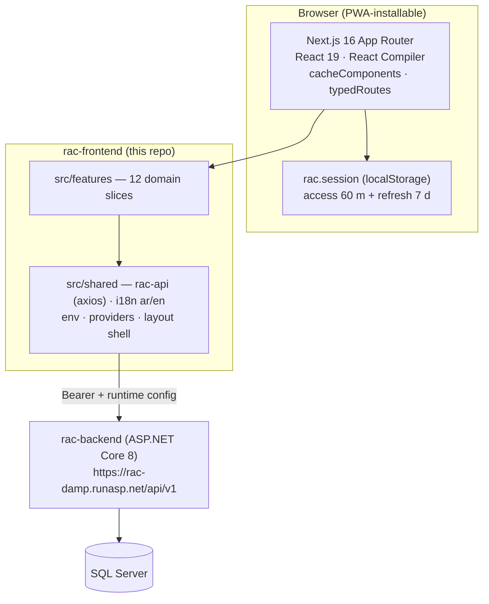
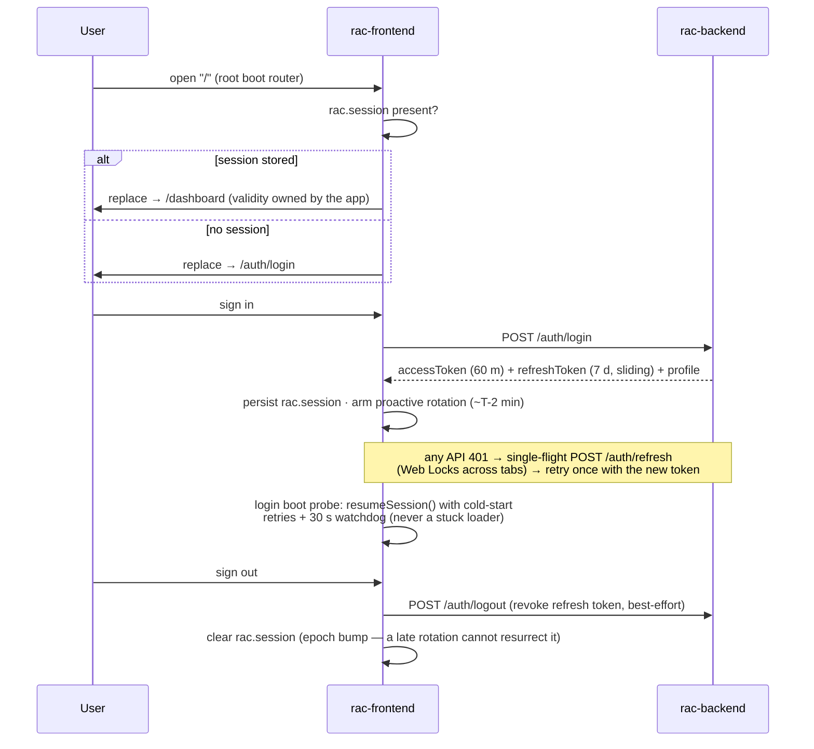
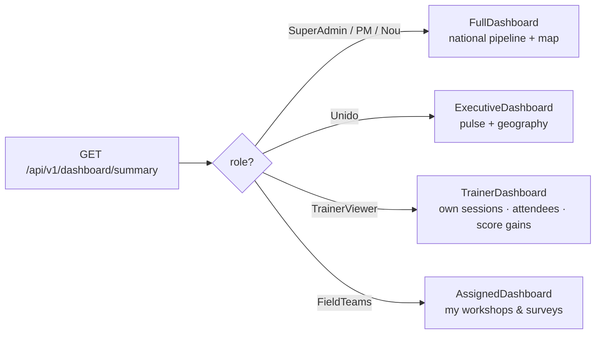
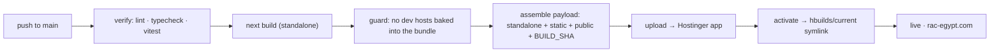

<div align="center">


# MAC-DAMP Frontend

**Bilingual (Arabic-first RTL / English) M&E web platform for Egypt's mobile air-conditioning servicing sector.**

Next.js 16 · React 19 · Tailwind v4 · shadcn/ui

[](https://github.com/Zahrannnn/rac-frontend/actions/workflows/frontend-deploy.yml)


</div>

> [!NOTE]
> MAC-DAMP (Mobile Air Conditioning — Digital Assessment & Monitoring Platform) digitizes the
> full program lifecycle for a UNIDO / NOU / EED initiative: workshop identification → survey →
> validation & selection → training → equipment handover → reports. This repo is the web client;
> it consumes the [ASP.NET Core 8 API](https://github.com/Zahrannnn/rac-backend) under `/api/v1`.

## Contents

- [Features](#features)
- [Architecture](#architecture)
- [Authentication & session](#authentication--session)
- [Roles & permission surfaces](#roles--permission-surfaces)
- [Tech stack](#tech-stack)
- [Getting started](#getting-started)
- [Configuration](#configuration)
- [Project structure](#project-structure)
- [Testing](#testing)
- [CI/CD & deployment](#cicd--deployment)
- [i18n & RTL conventions](#i18n--rtl-conventions)
- [Troubleshooting](#troubleshooting)
- [Further reading](#further-reading)

## Features

| Module | Route(s) | What it does |
| --- | --- | --- |
| Dashboard | `/dashboard` | Role-shaped KPI view (see [Roles](#roles--permission-surfaces)) — every figure traces to the database |
| Workshops | `/workshops`, `/workshops/new`, `/workshops/[id]` | Registry, registration wizard with duplicate detection, profile & edit |
| Surveys | `/surveys`, `/workshops/[id]/survey` | 13-section field survey wizard — GPS + photo evidence, governorate dropdown, Arabic-first UX |
| Selection | `/selection`, `/selection/runs/[runId]` | Machine-scored rubric runs, ranked recommendations, run exports |
| Trainings | `/trainings` | Training records: sessions, participants with pre/post scores, photos — trainers manage their own sessions |
| Equipment deliveries | `/equipment-deliveries`, `/equipments` | Delivery log with recipients, photos, date filtering |
| Reports | `/reports` | 9 catalog reports as bilingual Excel workbooks (AR RTL + EN sheets, charts, data bars, Cairo-time stamps) |
| Admin | `/admin/users`, `/admin/permissions`, `/admin/audit` | User management, permission matrix editor, audit trail |

## Architecture

Feature-first: `src/app` routes are thin compositions; each domain slice owns its API adapter,
hooks, components, and validations in `src/features`; cross-cutting infrastructure lives in
`src/shared`. Cross-feature access goes through a feature's `index.ts` — never its internals.



Layered protection instead of middleware: per-route `RequirePermission` guards, a
permission-filtered sidebar/command palette, and a 401 interceptor that rotates the session
(see below). Excel report generation is server-side — this client only requests and
downloads the workbooks.

## Authentication & session

Bearer tokens in `localStorage` — deliberate: the frontend and API live on different origins
under third-party-cookie blocking. The client runs a full token-rotation lifecycle:



A definitively rejected refresh clears the session and returns the user to
`/auth/login?next=…`; transport failures (idle hosted backend) keep the session and retry.

## Roles & permission surfaces

Six roles, one configurable permission matrix (edited live at `/admin/permissions` —
nothing is hardcoded per feature). Nav and actions render from `user.permissions`.

| Role | Dashboard shape | Visible surface |
| --- | --- | --- |
| SuperAdmin | Full | Everything + admin |
| ProjectManager | Full | All program modules |
| Nou | Full | All program modules |
| Unido | Executive | Selection, Reports |
| TrainerViewer | Trainer | Trainings only — own sessions (TrainerKey-scoped), participants & scores |
| FieldTeams | Assigned | Workshops, Technicians, Surveys — only assigned workshops |



## Tech stack

| | |
| --- | --- |
| Framework | Next.js 16 (App Router, `cacheComponents`, `reactCompiler`, `typedRoutes`, `output: "standalone"`) · React 19.2 · TypeScript 5 |
| Styling | Tailwind CSS v4 (`@theme` tokens in `globals.css`) · shadcn/ui (new-york) · Radix |
| Data | TanStack Query 5 · Axios (20 s timeout, cold-start retries) · Zod 4 (env + form schemas) |
| UI extras | Leaflet + react-leaflet 5 (OSM) · Recharts · next-themes · sonner · lucide-react |
| Testing | Vitest 4 + Testing Library (jsdom) — 409 tests in 68 colocated files |
| Delivery | GitHub Actions → prebuilt standalone payload → Hostinger (see [CI/CD](#cicd--deployment)) |

## Getting started

**Prerequisites:** Node 22 · npm 10 · the [backend](https://github.com/Zahrannnn/rac-backend)
running locally on `http://localhost:5161` (seeded admin account: see its README).

```bash
npm install
npm run dev        # http://localhost:3000 — Arabic RTL by default
```

> [!IMPORTANT]
> `.env.local` is git-ignored and **must not exist during CI/production builds** — its
> `NEXT_PUBLIC_RAC_API_BASE_URL` gets baked into the bundle. CI has a guard that fails the
> deploy if any `localhost:5161` host is found in the shipped assets.

The one-command gate every change must pass before handoff:

```bash
npm run verify     # eslint → tsc --noEmit → vitest run → next build
```

## Configuration

Public env is validated by Zod (`src/shared/config/env.ts`) and merged from two sources:
build-time `process.env` wins in development; in production a static
`public/runtime-env.js` (loaded `beforeInteractive` as `window.__RUNTIME_CONFIG__`) lets the
API URL change **without rebuilding**.

| Variable | Default | Purpose |
| --- | --- | --- |
| `NEXT_PUBLIC_APP_NAME` | `MAC-DAMP` | Brand name across the shell |
| `NEXT_PUBLIC_APP_URL` | `http://localhost:3000` | Canonical site URL (metadata, sitemap) |
| `NEXT_PUBLIC_RAC_API_BASE_URL` | *(empty)* | API base, e.g. `http://localhost:5161/api/v1` |
| `NEXT_PUBLIC_SHOW_HEALTH_URLS` | `false` | Expose backend health URLs on `/health` |

## Project structure

```
src/
├─ app/                     # thin routes
│  ├─ (auth)/auth/login     #   sign-in
│  ├─ (app)/                #   protected shell: dashboard, workshops, surveys,
│  │                        #   selection, trainings, equipment-deliveries,
│  │                        #   equipments, reports, admin/*
│  ├─ (public)/health       #   public health page
│  ├─ page.tsx              #   root boot router (session → dashboard | login)
│  └─ layout.tsx            #   <html lang="ar" dir="rtl"> · Cairo font · providers
├─ features/                # domain slices — api / hooks / components / validations / utils
│  ├─ auth/                 #   session adapter: rotation, cross-tab locks, 401 interceptor
│  ├─ dashboard/            #   4 role-shaped views (full / executive / trainer / assigned)
│  ├─ workshops/ surveys/ technicians/ selection/ trainings/
│  ├─ equipment-deliveries/ reports/ admin/ welcome/ health/
├─ shared/                  # cross-feature infra only
│  ├─ api/                  #   rac-api (axios instance) · http-client · file transfer
│  ├─ i18n/                 #   ar/en dictionaries (typecheck-enforced parity)
│  ├─ config/ constants/ providers/ components/ utils/ validation/
└─ components/ui/           # shadcn/ui primitives
```

## Testing

```bash
npm run test        # watch mode
npm run test:run    # 409 tests · 68 files
```

Coverage philosophy: every feature ships colocated tests for components, hooks, API
adapters, and validation utils — including i18n key-parity checks, the auth rotation
lifecycle (single-flight, cross-tab, watchdog), permission gating, and the PWA manifest.
Tests run on jsdom with the same React Query provider tree as the app.

## CI/CD & deployment

Every push to `main` builds and deploys automatically (`.github/workflows/frontend-deploy.yml`):



Production HTML is served with revalidate semantics (never a 1-year `s-maxage`) because the
site sits behind Hostinger's hcdn CDN — see the header rules in `next.config.ts`. Static,
content-hashed assets are immutable. `public/runtime-env.js` carries the live API endpoint.

## i18n & RTL conventions

- Arabic is the default language and direction (`<html lang="ar" dir="rtl">`); every screen
  works in both directions.
- One font family — **Cairo** — covers Arabic + Latin; zero letter-spacing on RTL small-caps.
- Logical CSS properties only (`ms-*`/`me-*`, `start-*`/`end-*`); never `left`/`right`.
  Directional icons flip with the locale; brand marks don't.
- `src/shared/i18n/ar.ts` and `en.ts` must stay in parity — TypeScript enforces it.
- Status is never color alone; badges always carry text labels.

## Troubleshooting

| Symptom | Cause & fix |
| --- | --- |
| First login of the day is slow / times out | The hosted backend sleeps when idle. The client retries transport failures with backoff (20 s timeout) — just wait or retry. |
| Changes "not applying" locally | Dev server + production build sharing `.next` can wedge Turbopack. Stop the dev server, `rm -rf .next`, re-run. |
| CI fails with "Dev API URL baked into the bundle" | A `.env.local` existed during the build. Delete it (or run the build without it) and push again. |
| Stale page on the CDN domain | Purge the hcdn cache from the Hostinger panel after deploys if an old document persists. |

## Further reading

- [`AGENTS.md`](./AGENTS.md) — working guide for agents and contributors
- [`docs/DESIGN.md`](./docs/DESIGN.md) — design system: palette, typography, components
- [`docs/architecture.md`](./docs/architecture.md) · [`docs/development.md`](./docs/development.md)
- [`rac-backend`](https://github.com/Zahrannnn/rac-backend) — API, RBAC matrix, report engine
